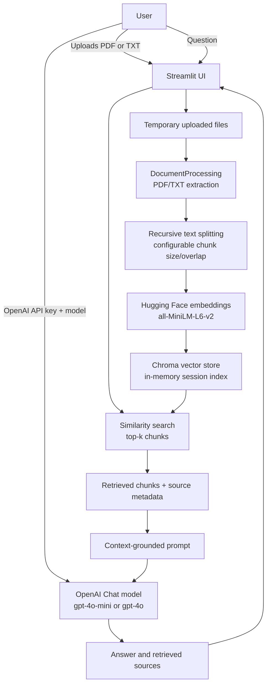

# RAG Document Search

A Streamlit app for asking questions about uploaded PDF and TXT documents. It uses retrieval-augmented generation (RAG): relevant document chunks are retrieved from a Chroma vector store and sent as context to an OpenAI chat model.

## Prerequisites

- Python 3.12 or newer
- [`uv`](https://docs.astral.sh/uv/getting-started/installation/) for dependency and environment management
- An OpenAI API key

## Setup

1. Open a terminal in the project directory:

   ```bash
   cd path/to/rag-document-search
   ```

2. Create the project environment and install dependencies:

   ```bash
   uv sync
   ```

3. Configure the OpenAI API key using either method:

   - Create a `.env` file in the project root:

     ```dotenv
     OPENAI_API_KEY=your-openai-api-key
     USER_AGENT=rag-document-search/1.0
     ```

   - Or enter the key in the app's sidebar after launch.

   Do not commit `.env` or share your API key.

## Run the app

From the project directory, run:

```bash
uv run python -m streamlit run streamlit_app.py
```

Open the local URL printed by Streamlit (usually <http://localhost:8501>). Using `uv run` ensures the app starts with the project's environment and installed dependencies.

## Use the app

1. Upload one or more PDF or TXT files.
2. Set the chunk size, overlap, and number of sources to retrieve in the sidebar.
3. Select **Build knowledge base** and wait for document processing and indexing to finish.
4. Enter a question in the chat box. The app retrieves relevant chunks and uses them to generate a response.
5. Expand **View retrieved sources** under an answer to inspect the document sections used.

The knowledge base is held in the running app's session; restarting the app clears it, so upload and index the files again.

## High-level architecture



The Streamlit app currently performs the end-to-end indexing and question-answering flow directly in `streamlit_app.py`. `src/document_injestion/` contains reusable document loaders; `src/vector_store/`, `src/nodes/`, `src/state/`, and `src/graph_builder/` contain supporting vector-store and LangGraph workflow modules.
